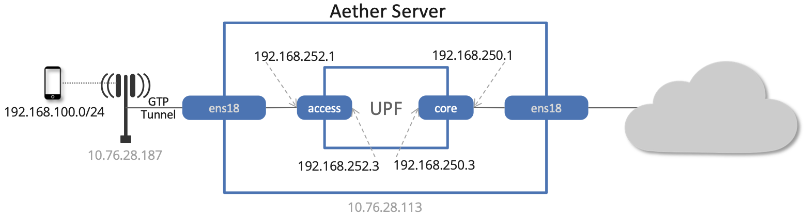
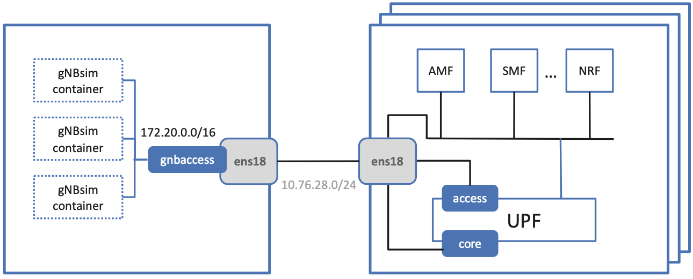
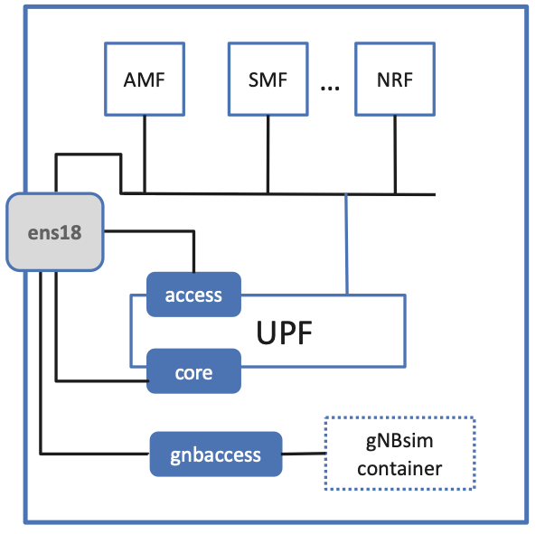

Verify Network
----------------

This section goes into depth on how SD-Core (which runs *inside* the
Kubernetes cluster) connects to either physical gNBs or an emulated
RAN (both running *outside* the Kubernetes cluster). It also describes
how to run diagnostics to debug potential problems.

For the purpose of this section, we assume you already have a scalable
cluster running (as outlined in the previous section), SD-Core has
been installed on that cluster, and you have a terminal window open on
the Master node in that cluster.

Network Schematic
~~~~~~~~~~~~~~~~~~~~~~~~~~

:numref:`Figure %s <fig-macvlan>` shows a high-level schematic of
Aether's end-to-end User Plane connectivity, where we start by
focusing on the basics: a single Aether node, a single physical gNB,
and just the UPF container running inside SD-Core. The identifiers
shown in gray in the figure (``10.76.28.187``, ``10.76.28.113``,
``ens18``) are taken from our running example of an actual
deployment (meaning your details will be different). All the other
names and addresses are part of a standard Aether configuration.

.. _fig-macvlan:

    The UPF pod running inside the server hosting Aether, with
    ``core`` and ``access`` bridging the two. Identifiers
    ``10.76.28.187``, ``10.76.28.113``, ``ens18`` are specific to
    a particular deployment site.

As shown in the figure, there are two bridges that connect the
physical interface (``ens18`` in our example) with the UPF
container. The ``access`` bridge connects the UPF downstream to the
RAN (this corresponds to 3GPP's N3 interface) and is assigned IP subnet
``192.168.252.0/24``.  The ``core`` bridge connects the UPF upstream
to the Internet (this corresponds to 3GPP's N6 interface) and is assigned
IP subnet ``192.168.250.0/24``.  This means, for example, that the
``access`` interface *inside* the UPF (which is assigned address
``192.168.252.3``) is the destination IP address of GTP-encapsulated
user plane packets from the gNB.

Following this basic schematic, it is possible to verify that the UPF
is connected to the network by checking to see that the ``core`` and
``access`` are properly configured. This can be done using ``ip``, and
you should see results similar to the following:

.. code-block::

   $ ip addr show core
   15: core@ens3: <BROADCAST,MULTICAST,UP,LOWER_UP> mtu 1500 qdisc noqueue state UP group default qlen 1000
       link/ether 06:f7:7c:65:31:fc brd ff:ff:ff:ff:ff:ff
       inet 192.168.250.1/24 brd 192.168.250.255 scope global core
          valid_lft forever preferred_lft forever
       inet6 fe80::4f7:7cff:fe65:31fc/64 scope link
          valid_lft forever preferred_lft forever

   $ ip addr show access
   14: access@ens3: <BROADCAST,MULTICAST,UP,LOWER_UP> mtu 1500 qdisc noqueue state UP group default qlen 1000
       link/ether 82:ef:d3:bb:d3:74 brd ff:ff:ff:ff:ff:ff
       inet 192.168.252.1/24 brd 192.168.252.255 scope global access
          valid_lft forever preferred_lft forever
       inet6 fe80::80ef:d3ff:febb:d374/64 scope link
          valid_lft forever preferred_lft forever

The above output from ``ip`` shows the two interfaces visible to the
server, but running *outside* the container. ``kubectl`` can be used
to see what's running *inside* the UPF, where ``bessd`` is the name of
the container image that implements the UPF, and ``access`` and
``core`` are the last two interfaces shown below:

.. code-block::

   $ kubectl -n aether-5gc exec -ti upf-0 bessd -- ip addr
   1: lo: <LOOPBACK,UP,LOWER_UP> mtu 65536 qdisc noqueue state UNKNOWN group default qlen 1000
       link/loopback 00:00:00:00:00:00 brd 00:00:00:00:00:00
       inet 127.0.0.1/8 scope host lo
       valid_lft forever preferred_lft forever
       inet6 ::1/128 scope host
       valid_lft forever preferred_lft forever
   3: eth0@if30: <BROADCAST,MULTICAST,UP,LOWER_UP> mtu 1450 qdisc noqueue state UP group default
       link/ether 8a:e2:64:10:4e:be brd ff:ff:ff:ff:ff:ff link-netnsid 0
       inet 192.168.84.19/32 scope global eth0
       valid_lft forever preferred_lft forever
       inet6 fe80::88e2:64ff:fe10:4ebe/64 scope link
       valid_lft forever preferred_lft forever
   4: access@if2: <BROADCAST,MULTICAST,UP,LOWER_UP> mtu 1500 qdisc noqueue state UP group default
       link/ether 82:b4:ea:00:50:3e brd ff:ff:ff:ff:ff:ff link-netnsid 0
       inet 192.168.252.3/24 brd 192.168.252.255 scope global access
       valid_lft forever preferred_lft forever
       inet6 fe80::80b4:eaff:fe00:503e/64 scope link
       valid_lft forever preferred_lft forever
   5: core@if2: <BROADCAST,MULTICAST,UP,LOWER_UP> mtu 1500 qdisc noqueue state UP group default
       link/ether 4e:ac:69:31:a3:88 brd ff:ff:ff:ff:ff:ff link-netnsid 0
       inet 192.168.250.3/24 brd 192.168.250.255 scope global core
       valid_lft forever preferred_lft forever
       inet6 fe80::4cac:69ff:fe31:a388/64 scope link
       valid_lft forever preferred_lft forever

When packets flowing upstream from the gNB arrive on the server's
physical interface, they need to be forwarded over the ``access``
interface.  This is done by having the following kernel route
installed, which should be the case if your Aether installation was
successful:

.. code-block::

   $ ip ro|grep "dev access"
   192.168.252.0/24 dev access proto kernel scope link src 192.168.252.1

Within the UPF, the correct behavior is to forward packets between the
``access`` and ``core`` interfaces.  Upstream packets arriving on the
``access`` interface have their GTP headers removed and the raw IP
packets are forwarded to the ``core`` interface.  The routes inside
the UPF's ``bessd`` container will look something like this:

.. code-block::

   $ kubectl -n aether-5gc exec -ti upf-0 -c bessd -- ip route
   default via 169.254.1.1 dev eth0
   default via 192.168.250.1 dev core metric 110
   10.76.28.0/24 via 192.168.252.1 dev access
   10.76.28.113 via 169.254.1.1 dev eth0
   169.254.1.1 dev eth0 scope link
   192.168.250.0/24 dev core proto kernel scope link src 192.168.250.3
   192.168.252.0/24 dev access proto kernel scope link src 192.168.252.3

The default route via ``192.168.250.1`` directs upstream packets to
the Internet via the ``core`` interface, with a next hop of the
``core`` interface outside the UPF.  These packets then undergo source
NAT in the kernel and are sent to the IP destination in the packet.
This means that the ``192.168.100.0/24`` addresses assigned to UEs are
not visible beyond the Aether server. The return (downstream) packets
undergo reverse NAT and now have a destination IP address of the UE.
They are forwarded by the kernel to the ``core`` interface by these
rules on the server:

.. code-block::

   $ ip ro |grep "dev core"
   192.168.100.0/24 via 192.168.250.3 dev core proto static
   192.168.250.0/24 dev core proto kernel scope link src 192.168.250.1

The first rule above matches packets to the UEs on the
``192.168.100.0/24`` subnet.  The next hop for these packets is the
``core`` IP address inside the UPF.  The second rule says that next
hop address is reachable on the ``core`` interface outside the UPF.
As a result, the downstream packets arrive in the UPF where they are
GTP-encapsulated with the IP address of the gNB.

Note that if you are not finding ``access`` and ``core`` interfaces
outside the UPF, the following commands can be used to create these
two interfaces manually (again using our running example for the
physical ethernet interface):

.. code-block::

    $ ip link add core link ens18 type macvlan mode bridge 192.168.250.3
    $ ip link add access link ens18 type macvlan mode bridge 192.168.252.3

Beyond this basic understanding, there are three other details of
note. First, we have been focusing on the User Plane because Control
Plane connectivity is much simpler: RAN elements (whether they are
physical gNBs or gNBsim) reach the AMF using the server's actual IP
address (``10.76.28.113`` in our running example). Kubernetes is
configured to forward SCTP packets arriving on port ``38412`` to the
AMF container.

Second, the basic end-to-end schematic shown in :numref:`Figure %s
<fig-macvlan>` assumes each gNB is assigned an address on the same L2
network as the Aether cluster (e.g., ``10.76.28.0/24`` in our example
scenario). This works when the gNB is physical or when we want to run
a single gNBsim traffic source, but once we scale up the gNBsim by
co-locating multiple containers on a single server, we need to
introduce another network so each container has a unique IP address
(even though the containers are all hosted on the same node). This more
complex configuration is depicted in :numref:`Figure %s <fig-gnbsim>`,
where ``172.20.0.0/16`` is the IP subnet for the virtual network (also
implemented by a Macvlan bridge, and named ``gnbaccess``).

.. _fig-gnbsim:

    A server running multiple instances of gNBsim, connected to
    Aether.

For completeness, :numref:`Figure %s <fig-start>` shows the Macvlan
setup for the Quick Start configuration, where both the ``gnbaccess``
bridge and gNBsim container run in the same server as the Core (but
with the container manged by Docker, independent of Kubernetes).

.. _fig-start:

    The Quick Start configuration with all components running in a
    single server.

Finally, all of the configurable parameters used throughout this
section are defined in the ``core`` and ``gnbsim`` sections of the
``vars/main.yml`` file. Note that an empty value for
``core.networks.access.ran_subnet`` implies the physical L2 network is
used to connect RAN elements to the core, as is typically the case
when connecting physical gNBs. Many of the other variables are
explained in subsequent sections, but for a summary, see the
:doc:`Quick Reference </onramp/ref>`.

.. code-block::

    core:
        standalone: true  # set to false to manage device groups/slices manually via the SD-Core webui
        values_file: "deps/5gc/roles/core/templates/sdcore-5g-values.yaml"
        networks:
            access:
                ran_subnet: "172.20.0.0/16"  # gNB network; "" derives it from the access interface
        helm:
            local_charts: false  # set chart_ref to local path name if true
            chart_ref: oci://ghcr.io/omec-project/sd-core
            chart_version: 6.1.0
        upf:
            mode: af_packet                    # Options: af_packet or dpdk
            instances:
                default:
                    ue_ip_pool: "192.168.100.0/24"
        amf:
            ip: "10.76.28.113"

    gnbsim:
        ...
        router:
            data_iface: ens18
            macvlan:
                iface: gnbaccess
                subnet_prefix: "172.20"

The ``core`` section no longer names a data interface: the Core uses
the interface carrying the server's default route. Only
``gnbsim.router.data_iface`` needs to be set to your server's
interface. Everything else about the UPF's networking is optional,
as described next.

UPF Networking
~~~~~~~~~~~~~~~~~

The UPF has two sides: *access* (N3, towards the gNBs) and *core* (N6,
towards the data network). Each side attaches to a *network*, which
is described by ``core.networks``. The list of UPFs, and the network
each of their sides uses, is described by ``core.upf.instances``.
Every field has a default, so with neither key set you get the
deployment OnRamp has always shipped: one UPF, both sides attached as
Macvlan children of the interface carrying the server's default route,
and the server acting as the gateway on ``192.168.252.0/24`` (access)
and ``192.168.250.0/24`` (core). The install prints the resolved UPF
networking so you can see what the defaults decided before anything is
deployed.

Each entry in ``core.networks`` (keyed by name) has the following
fields, all optional:

.. list-table::
   :widths: 15 30 55
   :header-rows: 1

   * - Field
     - Default
     - Description
   * - ``iface``
     - Interface carrying the default route
     - Host interface the network is reached through.
   * - ``vlan``
     - None
     - 802.1Q tag. The UPF attaches to ``<iface>.<vlan>``, which
       ``5gc-router-install`` creates on the host.
   * - ``subnet``
     - ``192.168.252.0/24`` for ``access``, ``192.168.250.0/24`` for
       ``core``
     - The network in CIDR form. Required for any other network.
   * - ``gateway``
     - ``host``
     - ``host`` makes the server the gateway, at the subnet's first
       address: it creates a Macvlan interface named after the network,
       forwards between it and ``iface``, routes each UPF's UE pool to
       that UPF, and masquerades the pools on the way out. An IP
       address names an external router instead, in which case OnRamp
       configures nothing on the host for this network.
   * - ``attach``
     - ``macvlan``
     - How the UPF pod attaches in ``af_packet`` mode. ``macvlan``
       shares the interface; ``host-device`` moves it into the pod,
       which requires an external gateway and makes the interface
       absent from the host while the UPF runs.
   * - ``resource_name``
     - ``intel.com/intel_sriov_vfio_access`` / ``..._core``
     - SR-IOV resource pool in ``dpdk`` mode. Required for networks
       other than ``access`` and ``core``.
   * - ``ran_subnet``
     - Derived from ``iface``'s own subnet
     - On an ``access`` network, the gNB network the UPF routes
       downstream traffic to. Set it explicitly when the gNBs are not on
       that interface's L2 network.

Each entry in ``core.upf.instances`` (keyed by name) has ``access`` and
``core`` (each ``{network, ip}``, defaulting to the network of the same
name and the third address of its subnet), ``ue_ip_pool`` (required
except for ``default``, which uses ``192.168.100.0/24``), and ``mode``
(defaults to ``core.upf.mode``). The instance named ``default`` is the
built-in UPF deployed with the Core and always exists. Every other
instance is deployed as its own release by ``5gc-upf-install``; see
the :doc:`Multiple UPFs </onramp/blueprints>` blueprint.

To put one side of the UPF on a different interface, name only what
differs. For example, the following moves the core side to a second NIC
whose router is not this server:

.. code-block::

    core:
        networks:
            core:
                iface: eno2
                subnet: 10.60.0.0/24
                gateway: 10.60.0.1

The install refuses configurations that cannot work rather than
deploying them. Examples include a gateway outside its subnet,
``host-device`` with the server as gateway, moving the interface that
carries the server's default route into a pod, a network used by both a
``dpdk`` and an ``af_packet`` UPF, two UPFs sharing an address,
overlapping UE pools, and unknown (or removed) keys. In ``dpdk`` mode
both sides of a UPF must be on the same interface, and ``attach`` does
not apply.

Uninstalling the router step restores the host to the state it was in
before the install (forwarding, GRO, and ``sysctl`` settings, plus any
VLAN interfaces OnRamp created).

Packet Traces
~~~~~~~~~~~~~~~~~

Successfully connecting a UE to the Internet involves configuring the
UE, gNB, and SD-Core software in a consistent way; establishing
SCTP-based control plane (N2) and GTP-based user plane (N3)
connections between the base station and Mobile Core; and traversing
multiple IP subnets along the end-to-end path.

Packet traces are the best way to diagnose your deployment, and the
most helpful traces you can capture are shown in the following
commands. You can run these on the Aether server, where we use our
example ``ens18`` interface for illustrative purposes:

.. code-block::

   $ sudo tcpdump -i any sctp -w sctp-test.pcap
   $ sudo tcpdump -i ens18 port 2152 -w n3-outside.pcap
   $ sudo tcpdump -i access port 2152 -w n3-inside.pcap
   $ sudo tcpdump -i core net 192.168.100.0/24 -w n6-inside.pcap
   $ sudo tcpdump -i ens18 net 192.168.100.0/24 -w n6-outside.pcap

The first trace, saved in file ``sctp.pcap``, captures SCTP packets
sent to establish the control path between the base station and the
Mobile Core (over the **N2** interface). Toggling "Mobile Data" on a
physical UE, for example by turning Airplane Mode off and on, will
generate the relevant control plane traffic; gNBsim automatically
triggers this activity.

The second and third traces, saved in files ``n3-outside.pcap`` and
``n3-inside.pcap``, respectively, capture GTP packets (tunneled
through port ``2152`` ) on the RAN side of the UPF. Setting the
interface to ``ens18`` corresponds to "outside" the UPF and setting
the interface to ``access`` corresponds to "inside" the UPF.  Running
``ping`` from a physical UE will generate the relevant user plane traffic
(over the **N3** interface); gNBsim automatically triggers this activity.

Similarly, the fourth and fifth traces, saved in files
``n6-inside.pcap`` and ``n6-outside.pcap``, respectively, capture IP
packets on the Internet side of the UPF (over the **N6** interface).
In these two tests, ``net 192.168.100.0/24`` corresponds to the IP
addresses assigned to UEs by the SMF. Running ``ping`` from a physical
UE will generate the relevant user plane traffic; gNBsim automatically
triggers this activity.

If the ``n3-outside.pcap`` has packets and the ``n3-inside.pcap``
is empty (no packets captured), you may run the following commands
to make sure packets are forwarded from the ``ens18`` interface
to the ``access`` interface and vice versa:

.. code-block::

   $ sudo iptables -A FORWARD -i ens18 -o access -j ACCEPT
   $ sudo iptables -A FORWARD -i access -o ens18 -j ACCEPT
